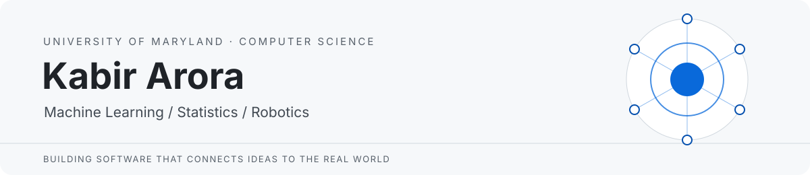

<picture>
  <source media="(prefers-color-scheme: dark)" srcset="assets/profile-dark.svg">
  
</picture>

> **DOSSIER** · Computer Science @ UMD · Machine Learning + Statistics · Exploring SWE, AI/ML, robotics, and data science

## About

I'm studying Computer Science at the University of Maryland, College Park, specializing in Machine Learning and double majoring in Statistics (expected 2028). I like building practical systems across software, AI, and robotics, and I'm always open to a new challenge and learning something new.

## Selected work

| Project | Specialty | Field notes |
|:--|:--|:--|
| [Deuces Arena](https://github.com/Kabirsarora/deuces-arena) · [Live demo](https://deucesarena.com) | Full-stack systems | Real-time multiplayer game, reusable TypeScript engine, Socket.IO, PostgreSQL, simulation-based bots |
| [Thought Vault](https://github.com/Open-Sourcery-UMD/thought-vault) · [My fork](https://github.com/Kabirsarora/thought-vault) | Applied machine learning | Team project for semantic note search and automatic topic organization |
| Underwater robotics & computer vision | Robotics | Fish-classification workflows, camera processing, and software-controlled aquatic robot systems |
| [Resume Studio](https://github.com/Kabirsarora/Resume-analyzer-project) | Python · AI | Resume feedback and job-specific tailoring with Flask |

## Selected impact

| Multiplayer systems | Computer vision | Robotics |
|:--:|:--:|:--:|
| **150+** early players on Deuces Arena | **88%** fish-classification accuracy on a held-out dataset | **<100 ms** robot command latency |

## Technical toolkit

**Languages** · Java · Python · JavaScript · TypeScript · C · OCaml · Rust · HTML/CSS  
**Frameworks & libraries** · React · Next.js · Express · Socket.IO · Flask · Django · OpenCV · NumPy · pandas · scikit-learn  
**Data & tools** · PostgreSQL · Prisma · MongoDB · Git · GitHub · Node.js · Vercel · Render · Neon

## Achievements

George Hacks × United Nations “Reboot the Earth” Hackathon track winner · USACO Gold · PCEP Python Certified · FTC Lead Connect Award

---

[All repositories](https://github.com/Kabirsarora?tab=repositories) · [Thought Vault team](https://github.com/Open-Sourcery-UMD/thought-vault)
